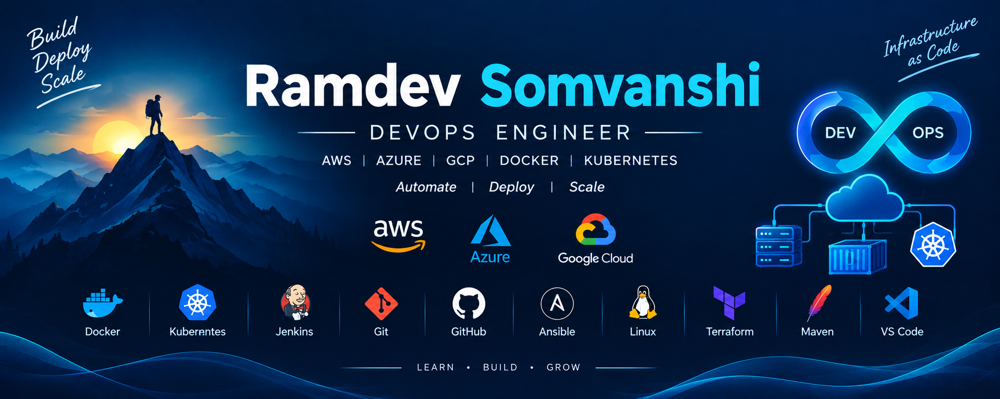

# 👋 Hi, I'm Ramdev Somvanshi

### 🚀 DevOps Engineer | AWS | Azure | GCP | Docker | Kubernetes

---

## 💫 About Me

- 👨‍💻 Third-year Bachelor of Computer Applications (BCA) student.
- 🚀 Passionate about DevOps, Cloud Computing and Automation.
- ☁️ Exploring AWS, Microsoft Azure and Google Cloud Platform.
- 🐳 Hands-on practice with Docker and Kubernetes.
- ⚙️ Learning CI/CD automation using Jenkins and AWS CodeBuild.
- 🔧 Working with Git, GitHub, Linux and Ansible.
- 🎯 Focused on building, deploying and managing cloud-native applications.
- 📚 Continuously learning modern DevOps technologies.

---

## 🛠️ DevOps Tech Stack

### ☁️ Cloud Platforms

### 🚀 DevOps & CI/CD

### 🐳 Containers & Orchestration

### 💻 Programming & Tools

---

## ⚡ Technical Skills

| Category | Technologies |
|---|---|
| Cloud | AWS, Azure, GCP |
| Containers | Docker, Docker Compose |
| Orchestration | Kubernetes, Amazon EKS |
| CI/CD | Jenkins, AWS CodeBuild |
| Configuration Management | Ansible |
| Version Control | Git, GitHub |
| Operating System | Linux |
| Build Tools | Maven |
| Scripting | Bash |
| AWS Services | EC2, S3, IAM, Lambda, CloudWatch, API Gateway |

---

## 📂 Featured Projects

### 🏗️ 1. CareerSphere – Career Platform

**Connect. Apply. Grow.**

- Developed a responsive career platform using React and Vite.
- Created student, recruiter and admin interfaces.
- Implemented modern UI components and responsive layouts.
- Practiced frontend development and Git-based workflows.

**Technologies:** React, JavaScript, Vite, Tailwind CSS, Git, GitHub.

### 🐳 2. Dockerized 3-Tier Application

- Designed frontend, backend and database architecture.
- Containerized application components using Docker.
- Created multi-container deployments using Docker Compose.
- Configured Docker networking and persistent storage.
- Practiced container-to-container communication.

**Technologies:** Docker, Docker Compose, Linux, YAML.

### ☁️ 3. AWS Cloud & Kubernetes Labs

- Practiced EC2 instance management.
- Worked with IAM roles and Security Groups.
- Explored S3 bucket policies and encryption.
- Practiced AWS Lambda and CloudWatch.
- Created and managed Amazon EKS clusters.
- Deployed applications using Kubernetes Deployments and Services.

**Technologies:** AWS, EC2, S3, IAM, Lambda, EKS, Kubernetes.

---

## 🧪 Hands-On DevOps Experience

### Kubernetes

- Pods and ReplicaSets
- Deployments and Rollouts
- Rollback Operations
- Namespaces
- ClusterIP and NodePort Services
- LoadBalancer Services
- Application Scaling

### AWS Cloud

- EC2
- S3
- IAM
- VPC
- Security Groups
- Lambda
- CloudWatch
- API Gateway
- Amazon EKS

### CI/CD Automation

- Jenkins
- GitHub Integration
- AWS CodeBuild
- Buildspec YAML
- Maven Build Automation
- Automated Build Workflows

### Docker & Linux

- Docker Images and Containers
- Dockerfiles
- Docker Compose
- Container Networking
- Linux Commands
- Bash Scripting

---

## 📊 GitHub Statistics

---

## 🔥 GitHub Contribution Streak

---

## 🏆 GitHub Trophies

---

## 📈 Contribution Activity

---

## 🐍 Contribution Snake

---

## 🎯 Current Learning Goals

- 🚀 Advanced Kubernetes Administration
- ☁️ AWS Cloud Architecture
- 🔄 CI/CD Pipeline Automation
- 🏗️ Infrastructure as Code (IaC)
- 🐳 Advanced Docker & Containerization
- ⚙️ Ansible Automation
- 📡 Cloud-Native Application Deployment

---

## 💡 My DevOps Philosophy

> Automate everything possible, continuously improve infrastructure, and build reliable systems that scale.

---

### 🤝 Let's Connect and Build Something Amazing!

**Thanks for visiting my GitHub profile!**

⭐ From [Ramdev Somvanshi](https://github.com/ramsomvanshi)

